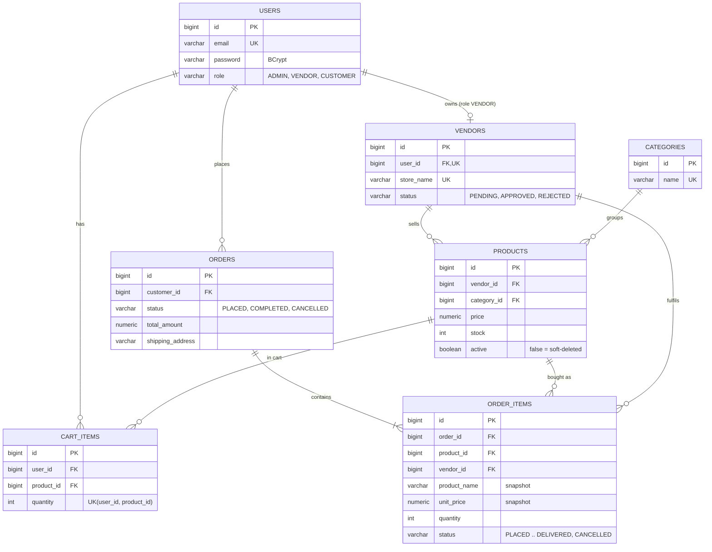

# Multi-Vendor E-Commerce Platform

A REST backend for a marketplace where **many vendors sell through one storefront**. Customers browse a shared catalogue, fill one cart with products from different vendors and check out once. Each vendor then sees and fulfils only its own items.

Built with Java 17, Spring Boot 3, Spring Security, JWT, Spring Data JPA, Hibernate, and PostgreSQL.

---

## Features

| Role | What they can do |
|------|------------------|
| **Public (no login)** | Browse/search/filter/sort/paginate products, view product details, list categories, register, log in |
| **Customer** | Cart (add / change quantity / remove / clear), checkout, order history, view an order, cancel an order (while no vendor has started processing it) |
| **Vendor** | Register a store (starts as `PENDING`), manage own products (create / edit / soft-delete / list), see own order lines, move them through `CONFIRMED -> SHIPPED -> DELIVERED` or cancel them |
| **Admin** | Approve or reject vendors, manage categories |

Other highlights:

- Stateless **JWT** authentication, **BCrypt** password hashing, **role-based** authorization.
- **Atomic checkout** with pessimistic row locking, so stock can never be oversold.
- Order lines **snapshot price and product name** at purchase time.
- Consistent JSON error responses with correct HTTP status codes and per-field validation messages.
- Unit tests (Mockito) and end-to-end integration tests (MockMvc + H2) through the real security chain.

---

## Tech stack

| Concern | Choice |
|---------|--------|
| Language / runtime | Java 17 |
| Framework | Spring Boot 3.3.5 (Web, Validation) |
| Security | Spring Security 6, JWT via `jjwt` 0.12 (HMAC-SHA) |
| Persistence | Spring Data JPA, Hibernate 6, PostgreSQL |
| Build | Maven |
| Tests | JUnit 5, Mockito, AssertJ, MockMvc, H2 (tests only) |
| Boilerplate | Lombok (getters/setters/constructors) |

---

## Project structure

```
src/main/java/com/marketplace
├── MarketplaceApplication.java
├── config/        SecurityConfig (filter chain, rules, BCrypt), DataSeeder (admin + categories)
├── security/      JwtService, JwtAuthFilter, CustomUserDetailsService, UserPrincipal
├── controller/    Thin REST controllers: Auth, Admin, Catalog, Vendor, Cart, Order
├── service/       Business logic: Auth, Vendor, Category, Product, Cart, Order (+ Mapper)
├── repository/    Spring Data repositories (+ ProductSpecifications for dynamic search)
├── entity/        JPA entities and enums
├── dto/           Request/response records with Bean Validation
└── exception/     Custom exceptions + GlobalExceptionHandler
```

Request flow: `Controller` (HTTP + validation) -> `Service` (business rules + transactions) -> `Repository` (JPA). Entities are never returned from the API; services map them to DTO records.

---

## Database design

PostgreSQL schema: [`database/schema.sql`](database/schema.sql). (Hibernate also creates the same tables automatically with the default `ddl-auto=update`.)



Design notes:

- **One `users` table with a `role`**, plus a `vendors` table holding the store profile (1:1 with a vendor user). Keeps authentication simple while vendor data stays separate.
- **`order_items` is the unit of fulfilment.** In a multi-vendor order each vendor ships its own lines, so the fulfilment status lives on the line, not on the order. `vendor_id` is stored on the line (denormalised on purpose) so "show me my orders" is a single indexed query.
- **Price and product name are copied** onto `order_items`; later product edits never rewrite order history.
- **Soft delete for products** (`active = false`): old orders still reference the row.
- **Constraints in the database as well as in code**: unique e-mail / store name / category name, `price > 0`, `stock >= 0`, `quantity > 0`, enum check constraints, foreign keys, and `UNIQUE (user_id, product_id)` on the cart. Indexes on every foreign key used for lookups.
- Money is `NUMERIC(12,2)` / `BigDecimal`, never floating point.

---

## Security

1. `POST /api/auth/register` stores a **BCrypt** hash (never the raw password). Only `CUSTOMER` and `VENDOR` can self-register; **admins cannot** (the first admin is seeded from configuration).
2. `POST /api/auth/login` verifies credentials through Spring's `AuthenticationManager` and returns a signed **JWT** (subject = e-mail, claims `uid` and `role`, expiry from `app.jwt.expiration-ms`).
3. `JwtAuthFilter` runs on every request: it validates signature and expiry, loads the user and puts it in the `SecurityContext`. A missing/invalid token just leaves the request anonymous.
4. `SecurityConfig` authorises by URL prefix: `/api/auth/**` and `GET /api/products|categories/**` are public, `/api/admin/**` -> `ADMIN`, `/api/vendor/**` -> `VENDOR`, `/api/cart/**` and `/api/orders/**` -> `CUSTOMER`. No token -> **401**, wrong role -> **403**, both as JSON.
5. **Ownership is enforced in the data layer, not just by role.** Services never trust an id from the client alone: they query `findByIdAndVendorId` / `findByIdAndCustomerId`, so another user's resource is reported as **404**. The user id always comes from the token (`@AuthenticationPrincipal`), never from the request body.
6. Sessions are **stateless** and CSRF is disabled (token in `Authorization` header, no cookies).
7. Login failures return the same message for "unknown e-mail" and "wrong password" (no account enumeration).
8. The JWT secret must be >= 32 characters; the app refuses to start otherwise. **Set `JWT_SECRET` in any real deployment.**

---

## Business rules

- **Vendor approval:** a new vendor is `PENDING`. Only `APPROVED` vendors can create/edit/delete products (403 otherwise).
- **Cart:** one row per (customer, product). Adding more than the available stock is rejected. Quantities are re-checked at checkout.
- **Checkout** (single transaction):
  1. read cart (error if empty);
  2. lock each product row (`SELECT ... FOR UPDATE`) **in ascending product-id order**;
  3. verify the product is still active and stock is sufficient;
  4. decrement stock, create order lines (snapshotting price/name, tagged with the vendor), compute the total;
  5. save the order and empty the cart.
  If anything fails, the whole transaction rolls back and nothing changes.
- **Fulfilment:** a vendor moves its own lines `PLACED -> CONFIRMED -> SHIPPED -> DELIVERED`, or cancels before shipping (stock is returned). Steps cannot be skipped.
- **Order status is derived:** `CANCELLED` if all lines are cancelled, `COMPLETED` if all lines are delivered/cancelled, otherwise `PLACED`.
- **Customer cancellation:** allowed only while every line is still `PLACED`; stock is returned; cancelling twice is rejected (no double restock).

---

## API reference

Base URL: `http://localhost:8080`. Send `Authorization: Bearer <token>` for protected endpoints. List endpoints return `{content, page, size, totalElements, totalPages}`.

### Auth (public)
| Method | Path | Description |
|--------|------|-------------|
| POST | `/api/auth/register` | Register `CUSTOMER` or `VENDOR` (vendors also send `storeName`). Returns a token |
| POST | `/api/auth/login` | Log in, returns a token |

### Catalogue (public)
| Method | Path | Description |
|--------|------|-------------|
| GET | `/api/categories` | All categories |
| GET | `/api/products` | Search. Params: `q`, `categoryId`, `minPrice`, `maxPrice`, `page`, `size` (max 100), `sortBy` (`createdAt`, `price`, `name`, `id`), `direction` (`asc`/`desc`) |
| GET | `/api/products/{id}` | Product details (active products only) |

### Admin (`ROLE_ADMIN`)
| Method | Path | Description |
|--------|------|-------------|
| GET | `/api/admin/vendors?status=PENDING` | List vendors, optional status filter |
| PUT | `/api/admin/vendors/{id}/approve` | Approve a vendor |
| PUT | `/api/admin/vendors/{id}/reject` | Reject a vendor |
| POST | `/api/admin/categories` | Create category |
| PUT | `/api/admin/categories/{id}` | Update category |
| DELETE | `/api/admin/categories/{id}` | Delete category (409 if it still has products) |

### Vendor (`ROLE_VENDOR`)
| Method | Path | Description |
|--------|------|-------------|
| GET | `/api/vendor/profile` | Own store profile and approval status |
| POST | `/api/vendor/products` | Create product (approved vendors only) |
| PUT | `/api/vendor/products/{id}` | Update own product |
| DELETE | `/api/vendor/products/{id}` | Soft-delete own product |
| GET | `/api/vendor/products` | List own products (paged) |
| GET | `/api/vendor/orders?status=` | Own order lines (with shipping address), optional status filter |
| PUT | `/api/vendor/orders/items/{itemId}/status` | Body `{"status":"CONFIRMED"}`; allowed: next step or `CANCELLED` |

### Customer (`ROLE_CUSTOMER`)
| Method | Path | Description |
|--------|------|-------------|
| GET | `/api/cart` | View cart with totals |
| POST | `/api/cart/items` | Body `{"productId":1,"quantity":2}` (adds to existing quantity) |
| PUT | `/api/cart/items/{productId}` | Body `{"quantity":3}` (sets quantity) |
| DELETE | `/api/cart/items/{productId}` | Remove one product |
| DELETE | `/api/cart` | Clear cart |
| POST | `/api/orders` | Checkout. Body `{"shippingAddress":"..."}` |
| GET | `/api/orders` | Own orders (paged) |
| GET | `/api/orders/{id}` | One own order |
| PUT | `/api/orders/{id}/cancel` | Cancel (only before any vendor started processing) |

### Error format
```json
{
  "timestamp": "2026-10-17T16:30:00",
  "status": 400,
  "error": "Bad Request",
  "message": "Validation failed",
  "fieldErrors": { "email": "must be a well-formed email address" }
}
```
| Status | When |
|--------|------|
| 400 | Validation errors, malformed JSON, business rule violations (empty cart, insufficient stock, invalid status change) |
| 401 | Missing/invalid/expired token, wrong credentials |
| 403 | Wrong role, or vendor not approved yet |
| 404 | Not found, or the resource belongs to someone else |
| 409 | Duplicate e-mail / store / category, category still in use |

---

## Getting started

### Prerequisites
- JDK 17
- PostgreSQL 14+ (local installation or Docker)

The Maven Wrapper is included, so a separate Maven installation is not required. On Windows, install JDK 17 if needed:

```powershell
winget install --id EclipseAdoptium.Temurin.17.JDK
```

Open a new PowerShell window, then set `JAVA_HOME` for that session. This command finds an Eclipse Temurin 17 installation; adjust the path if you installed another JDK distribution:

```powershell
$jdk = Get-ChildItem 'C:\Program Files\Eclipse Adoptium' -Directory -Filter 'jdk-17*' |
    Select-Object -First 1
if (-not $jdk) { throw 'JDK 17 was not found. Set JAVA_HOME to your JDK 17 installation.' }
$env:JAVA_HOME = $jdk.FullName
$env:Path = "$env:JAVA_HOME\bin;$env:Path"
.\mvnw.cmd -v
```

Confirm the output reports Java 17. If you keep multiple JDKs installed, set `JAVA_HOME` in each new terminal before using the wrapper.

### Start PostgreSQL

With Docker:

```powershell
docker compose up -d
```

The Compose file creates `multivendor_db` with the `postgres` user and `postgres` password. Set those values for the application in the same PowerShell session:

```powershell
$env:DB_USERNAME = 'postgres'
$env:DB_PASSWORD = 'postgres'
```

Or use a local PostgreSQL server. Create the `multivendor_db` database and configure a user/password the app can use. The application defaults are `DB_USERNAME=marketplace_user` and `DB_PASSWORD=Marketplace@123`; override them if your local PostgreSQL credentials differ.

Tables are created on first start with Hibernate's `ddl-auto=update`. To create them using the SQL file instead, apply `database/schema.sql` to `multivendor_db` and set `DDL_AUTO=none`.

### Configure and run

The application settings are in `src/main/resources/application.properties`. The database and server settings can be overridden with environment variables:

| Variable | Default | Purpose |
|----------|---------|---------|
| `DB_URL` | `jdbc:postgresql://localhost:5432/multivendor_db` | JDBC URL |
| `DB_USERNAME` / `DB_PASSWORD` | `marketplace_user` / `Marketplace@123` | Database credentials |
| `JWT_SECRET` | (dev placeholder) | **Set a long random value (>= 32 chars) outside development** |
| `JWT_EXPIRATION_MS` | `86400000` | Token lifetime (24 h) |
| `ADMIN_EMAIL` / `ADMIN_PASSWORD` | `admin@marketplace.com` / `Admin@12345` | Seeded admin account |
| `DDL_AUTO` | `update` | `update` or `none` |
| `PORT` | `8080` | HTTP port |

Start the application from PowerShell:

```powershell
.\mvnw.cmd spring-boot:run
```

On first start, the app creates the configured admin account and seeds four categories. The API is available at `http://localhost:8080`.

To try the API, import `postman/MultiVendor-Ecommerce.postman_collection.json` into Postman. Run its requests in order; the collection stores generated tokens and IDs in variables.

---

## Testing

On Windows, run:

```powershell
.\mvnw.cmd test
```

On macOS or Linux, run `./mvnw test`. The tests use an in-memory H2 database and do not require PostgreSQL.

| Test class | Type | What it covers |
|-----------|------|----------------|
| `JwtServiceTest` | unit | token generation/validation, expiry, tampering, wrong secret, weak secret |
| `AuthServiceTest` | unit (Mockito) | admin self-registration blocked, duplicate e-mail, vendor needs a store name, vendor starts `PENDING`, password hashed |
| `VendorServiceTest` | unit (Mockito) | approval gate (approved / pending / rejected), status rules |
| `ProductServiceTest` | unit (Mockito) | ownership checks, update, soft delete, unknown category |
| `OrderServiceTest` | unit (Mockito) | multi-vendor checkout and totals, price snapshot, empty cart, insufficient stock, inactive product, cancel + restock, no double cancel, fulfilment transitions, derived order status |
| `MarketplaceFlowIntegrationTest` | integration (MockMvc + H2) | 401/403 rules, registration/login, vendor approval flow, catalogue search + soft delete, full purchase-to-delivery flow, cancel restocks, stock re-check at checkout, order privacy, multi-vendor order isolation |

---

## Design decisions and trade-offs

- **Pessimistic locking at checkout** (instead of optimistic versioning): the contested resource is a single stock counter that popular items hit concurrently; locking gives correctness without retry logic. Products are locked in id order to avoid deadlocks. Trade-off: slightly lower concurrency on very hot products.
- **Checkout reads the cart *without* loading products**, then re-reads each product under the lock, so the stock value it uses is always the latest committed one, never a stale cached copy.
- **Fulfilment status per order line** rather than per order, because vendors act independently.
- **DTO records + a small `Mapper`** instead of exposing entities: no lazy-loading surprises, no leaking of password hashes, and API shape is decoupled from the schema.
- **`open-in-view=false`** and `default_batch_fetch_size=50`: all lazy loading happens inside service transactions, and batch fetching avoids N+1 queries on paged lists.
- **Whitelisted sorting and capped page size** so clients can't trigger errors or expensive queries.
- **JPA Specifications** for the optional catalogue filters (clean dynamic queries, no nullable-parameter pitfalls).

### Assumptions
- Payment is out of scope: placing an order simply reserves stock. Orders have no payment state.
- One shipping address per order, entered at checkout.
- Currency-agnostic prices (a single currency is assumed).

### Possible improvements
- Payment integration and an order-level payment status; refresh tokens / token revocation.
- Product images, reviews, and vendor payouts/commission.
- Flyway migrations instead of `ddl-auto=update`, and Testcontainers (real PostgreSQL) for integration tests.
- OpenAPI/Swagger documentation and rate limiting on the auth endpoints.
